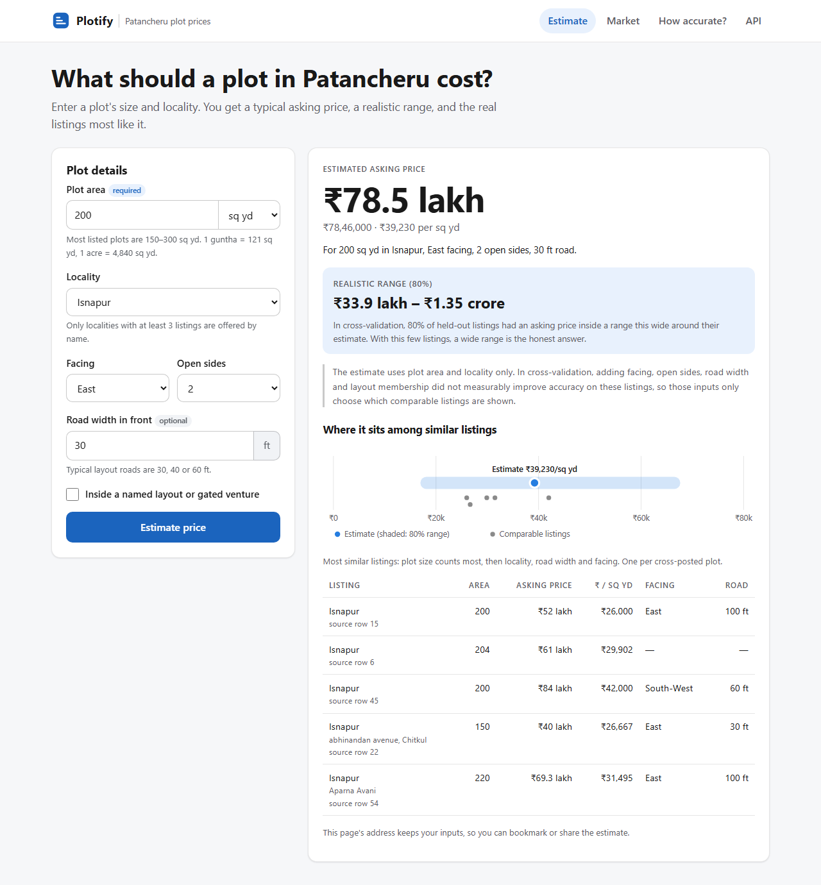
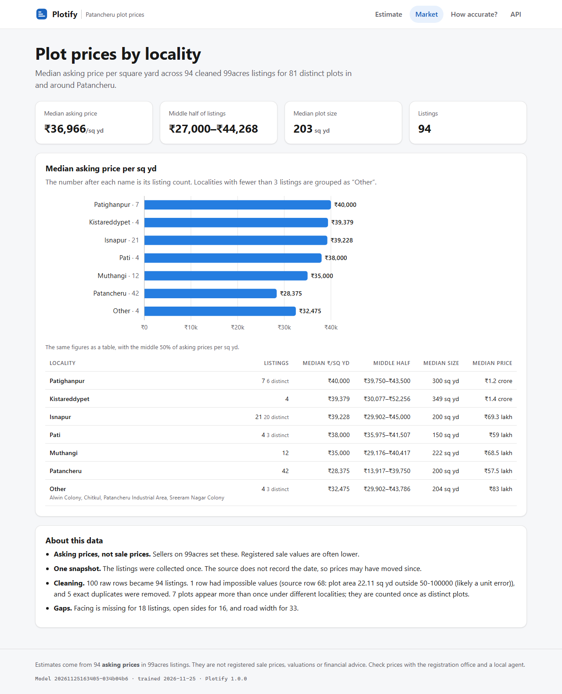
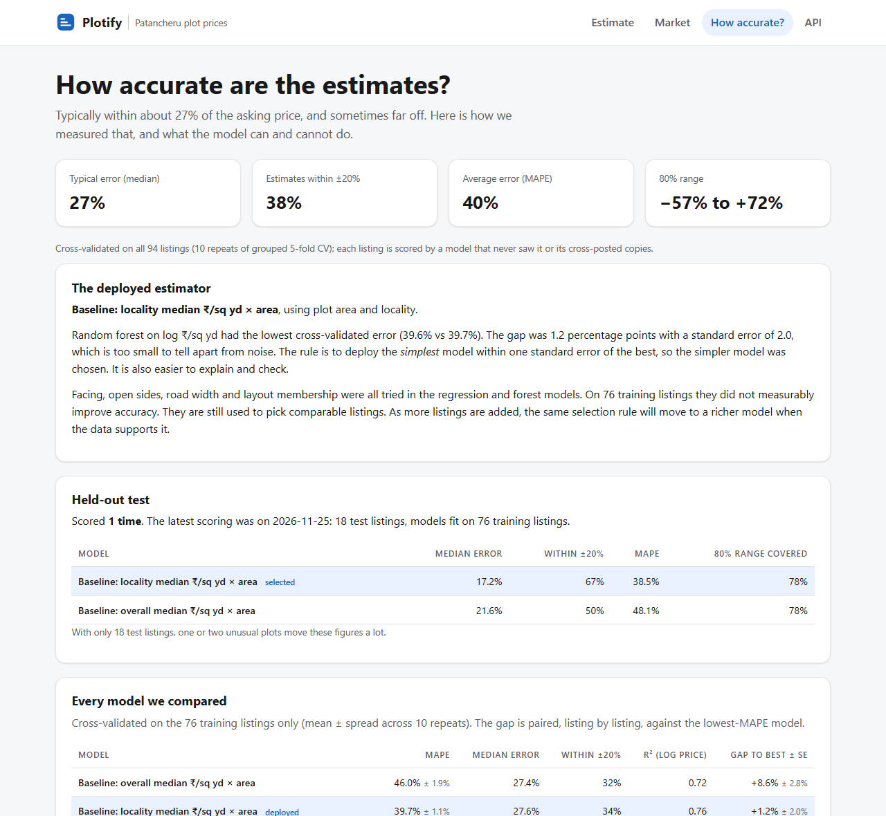

# Plotify – Residential Plot Price Prediction System

**Plotify** is an end-to-end machine learning application designed to estimate residential plot prices using real-estate listing data. The system integrates automated data collection, data preprocessing, exploratory data analysis, machine learning model evaluation, and web-based deployment into a unified pipeline.

The project uses residential plot listings collected from 99acres and provides price estimates, prediction ranges, comparable property listings, and locality-based market insights.

The current repository includes a dataset of 100 residential plot listings from Patancheru, Hyderabad. The pipeline is designed to support retraining with datasets from other geographical regions.

---

## Key Features

- **Residential Plot Price Prediction:** Estimates the expected asking price and price per square yard based on plot characteristics.
- **Prediction Intervals:** Provides an 80% prediction range based on historical model errors.
- **Comparable Property Listings:** Identifies similar properties to help users understand the estimated market value.
- **Locality-Based Market Insights:** Displays locality-wise median prices, price distribution, and listing counts.
- **Model Evaluation:** Compares multiple machine learning approaches using validation metrics and visualizations.
- **Flexible Area Inputs:** Supports square yards, square feet, square metres, guntha, and acres.
- **REST API Integration:** Enables predictions through structured JSON requests.
- **Command-Line Interface:** Supports data processing, model training, exploratory analysis, and predictions.
- **Regional Adaptability:** Allows the pipeline to be retrained using property listings from different locations.
- **Responsive Interface:** Provides a user-friendly experience across desktop and mobile devices, with light and dark themes.

## Application Screenshots

### Price Estimation



### Market Insights and Model Evaluation

| Market Insights | Model Evaluation |
|---|---|
|  |  |

---

## Project Workflow

The project follows a structured machine learning pipeline consisting of five major stages.

### 1. Data Collection

Property listing information is collected using **Selenium-based web scraping**.

The data collection module:
- Automates browser interactions using Selenium and Chrome WebDriver.
- Retrieves residential plot listings from 99acres.
- Extracts relevant property attributes, including price, location, plot area, facing direction, number of open sides, and road width.
- Collects listing information across multiple search result pages.
- Stores the extracted information in a structured dataset.

The collected dataset contains 100 residential plot listings from Patancheru, Hyderabad.

### 2. Data Cleaning and Preprocessing

The raw dataset is processed using Pandas and NumPy to ensure consistency and reliability.

Major preprocessing operations include:

- **Data Standardization:** Converts property prices, plot areas, and road widths into consistent numerical formats.
- **Unit Conversion:** Standardizes different area measurements into square yards.
- **Locality Extraction:** Identifies and separates locality names from property and project descriptions.
- **Data Validation:** Identifies invalid, inconsistent, and unrealistic property records.
- **Duplicate Removal:** Detects duplicate and repeated property listings to reduce data redundancy.
- **Missing Value Handling:** Handles incomplete optional attributes during model training.
- **Data Quality Reporting:** Maintains a record of excluded entries and their corresponding reasons.

**Dataset Summary:**

| Processing Stage | Records |
|---|---:|
| Raw Listings | 100 |
| Cleaned Listings | 94 |
| Distinct Property Records | 81 |

### 3. Exploratory Data Analysis

Exploratory Data Analysis (EDA) is performed to understand the distribution and relationships among property attributes.

The analysis includes:

- Distribution of price per square yard.
- Price variations across different localities.
- Relationship between plot area and property price.
- Impact of road width on property prices.
- Missing value analysis.
- Correlation analysis between numerical features.

The analysis indicates that **locality and plot size are the primary factors influencing property prices** within the available dataset.

### 4. Machine Learning Model Development

Five approaches are evaluated to identify a suitable prediction model.

| Model | Description |
|---|---|
| Overall Median Rate | Estimates price using the overall median price per square yard. |
| Locality Median Rate | Estimates price using the median price per square yard of the selected locality. |
| Linear Regression | Predicts property prices using relevant property attributes. |
| Ridge Regression | Applies regularization to improve model stability. |
| Random Forest | Uses an ensemble learning approach to model relationships between property features and prices. |

**Model Validation Strategy:**

- A separate 20% holdout test set is reserved before model comparison.
- Repeated grouped cross-validation is performed using 10 repetitions and 5 folds.
- Listings representing the same property are kept within the same data group to prevent data leakage.
- The one-standard-error selection rule is applied to balance model performance and simplicity.
- Prediction intervals are estimated using out-of-fold prediction errors.

### 5. Model Deployment

The selected machine learning model is integrated into a Flask-based web application.

The deployment architecture includes:

- Web-based interface for interactive price estimation.
- REST API for external application integration.
- Command-line interface for direct predictions and model operations.
- Shared prediction and validation logic across application components.
- Model persistence for consistent prediction results.

The application uses Waitress as its production WSGI server.

---

## Model Performance and Results

The following results were obtained using the included residential plot dataset.

### Cross-Validation Results

| Model | MAPE | Median Error | Within ±20% |
|---|---:|---:|---:|
| Overall Median Rate | 46.0% | 27.4% | 32% |
| **Locality Median Rate (Selected)** | **39.7%** | **27.6%** | **34%** |
| Linear Regression | 166.9% | 86.1% | 15% |
| Ridge Regression | 41.0% | 28.0% | 34% |
| Random Forest | 39.6% | 28.6% | 31% |

The Random Forest and Locality Median Rate approaches demonstrated statistically comparable performance. Considering model simplicity and interpretability, the Locality Median Rate approach was selected.

### Held-Out Test Results

The selected model was evaluated on 18 previously unseen property listings.

| Evaluation Metric | Selected Model | Overall Median Baseline |
|---|---:|---:|
| Median Error | 17.2% | 21.6% |
| Predictions Within ±20% | 67% | 50% |
| Mean Absolute Percentage Error | 38.5% | 48.1% |
| 80% Prediction Range Coverage | 78% | 78% |

The results demonstrate an improvement over the overall median baseline on the held-out test dataset.

**Note:** The predictions represent advertised asking prices rather than registered property transaction values. Performance may vary depending on dataset size, location, and listing quality.

---

## Application Modules

| Module | Description |
|---|---|
| Price Estimation | Accepts property details and generates estimated prices, prediction intervals, and comparable listings. |
| Market Insights | Presents locality-wise median prices, price distributions, and listing statistics. |
| Model Evaluation | Displays model comparisons, evaluation metrics, and prediction performance visualizations. |
| API Documentation | Provides API usage instructions and example requests and responses. |

---

## Technology Stack

| Category | Technologies |
|---|---|
| Programming Language | Python |
| Data Collection | Selenium, Chrome WebDriver |
| Data Processing | Pandas, NumPy |
| Machine Learning | Scikit-learn |
| Data Visualization | Matplotlib, SVG |
| Backend Framework | Flask |
| Production Server | Waitress |
| Frontend | HTML, CSS, Jinja2 |
| API | REST, JSON |
| Model Persistence | Joblib |
| Testing | Pytest |

---

## Installation and Setup

### Prerequisites

Ensure that the following software is installed:

- Python 3.11 or later
- Git

### 1. Clone the Repository

```bash
git clone https://github.com/<your-username>/<repository-name>.git
cd <repository-name>
```

### 2. Create a Virtual Environment

**Windows (PowerShell):**

```powershell
python -m venv .venv
.venv\Scripts\python -m pip install -r requirements-dev.txt
```

**macOS / Linux:**

```bash
python3 -m venv .venv
.venv/bin/python -m pip install -r requirements-dev.txt
```

### 3. Run Automated Tests

```bash
python -m pytest
```

### 4. Launch the Application

```bash
python -m plotify serve
```

Once the application starts, open the following address in your browser:

```text
http://127.0.0.1:8000
```

A trained model is included in the repository, allowing the application to run without requiring an initial training process.

---

## Command-Line Usage

Plotify provides a command-line interface for performing predictions, training models, and generating analytical reports.

**Generate a price prediction:**

```bash
python -m plotify predict --area 200 --locality Isnapur --facing East --road-width 30
```

**Generate a prediction in JSON format:**

```bash
python -m plotify predict --area 1800 --unit sqft --json
```

**Train and compare machine learning models:**

```bash
python -m plotify train
```

**Evaluate the selected model on the held-out test set:**

```bash
python -m plotify train --evaluate-test
```

**Perform exploratory data analysis:**

```bash
python -m plotify eda
```

---

## Training with Custom Datasets

The Plotify pipeline can be adapted to property listings from other geographical regions.

### Supported Dataset Formats

The system accepts CSV and Excel files containing the following columns:

| Column | Requirement | Example |
|---|---|---|
| Price | Required | 85 Lac, 1.2 Crore, 8500000 |
| Plot_Area | Required | 200, 1800 sq ft, 1 acre |
| Location | Required | Kothur, Shamshabad |
| facing | Optional | East, North-East |
| open_sides | Optional | 1, 2, 3, 4 |
| Width_road | Optional | 30 ft |

### Training Procedure

**1. Prepare the dataset**

Place the property listing dataset in the `data/raw/` directory.

**2. Train the model**

Specify the dataset path and geographical region:

```bash
python -m plotify train --data data/raw/my_listings.csv --region "Shamshabad"
```

**3. Evaluate and deploy**

After completing model development and validation, evaluate the held-out test set and launch the application:

```bash
python -m plotify train --evaluate-test
python -m plotify serve
```

The application automatically adapts its locality information and available defaults based on the newly trained dataset.

---

## REST API

Plotify provides a REST API for integrating property price predictions into external applications.

### Prediction Endpoint

**POST** `/api/v1/predict`

### Example Request

```json
{
  "area": 200,
  "area_unit": "sqyd",
  "locality": "Isnapur",
  "facing": "East",
  "open_sides": 2,
  "road_width_ft": 30,
  "in_project": false
}
```

Only the `area` field is required. Other property attributes are optional.

### Response Information

The API returns:

- Estimated property price.
- 80% prediction interval.
- Estimated price per square yard.
- Normalized input details.
- Relevant prediction warnings.
- Up to five comparable property listings.
- Model version information.

### Available API Endpoints

| Endpoint | Method | Description |
|---|---|---|
| `/api/v1/predict` | POST | Generates a residential plot price estimate. |
| `/api/v1/meta` | GET | Returns supported localities, measurement units, limits, and model information. |
| `/api/v1/health` | GET | Provides application health status. |

The API uses structured JSON responses for successful requests and error handling.

---

## Project Structure

```text
Plotify/
│
├── scraper/
│   └── data_extraction.py
│
├── data/
│   ├── raw/
│   └── processed/
│
├── plotify/
│   ├── cleaning.py
│   ├── modeling.py
│   ├── training.py
│   ├── service.py
│   ├── market.py
│   ├── web.py
│   ├── api.py
│   ├── charts.py
│   ├── eda.py
│   ├── bundle.py
│   ├── config.py
│   ├── security.py
│   ├── formatting.py
│   ├── templates/
│   └── static/
│
├── models/
│
├── reports/
│   └── figures/
│
├── tests/
│
├── docs/
│   └── screenshots/
│
├── legacy/
│
├── requirements.txt
├── requirements-dev.txt
└── pyproject.toml
```

---

## Testing

The project includes an automated test suite consisting of **154 tests**, covering the major components of the application.

Testing covers:

- Data cleaning and preprocessing.
- Property data validation and parsing.
- Machine learning model training and selection.
- Cross-validation and test-set evaluation.
- Price prediction and warning generation.
- Input validation and API functionality.
- Web application routes and error handling.
- Command-line operations.
- End-to-end training and deployment using datasets from different geographical regions.

Run the complete test suite using:

```bash
python -m pytest
```

---

## Limitations

The current implementation has the following limitations:

- **Dataset Size:** The initial dataset contains approximately 100 listings, which may limit the generalizability of predictions.
- **Asking Price Variations:** Predictions are based on advertised property prices and may differ from actual registered transaction values.
- **Geographical Coverage:** The included dataset primarily represents the Patancheru region of Hyderabad.
- **Property-Specific Factors:** Certain factors, including legal approvals, ownership documentation, exact geographical coordinates, and nearby amenities, are not currently incorporated into the prediction model.
- **Market Variations:** Property prices may change over time depending on local demand, infrastructure development, and market conditions.

The prediction results should therefore be treated as indicative estimates rather than definitive property valuations.

---

## Future Enhancements

Potential improvements to the project include:

- Expanding the dataset to cover additional localities and cities.
- Periodic data collection to monitor changes in property prices.
- Incorporating geographical coordinates and nearby infrastructure.
- Exploring additional machine learning models as more data becomes available.
- Integrating additional property-specific and location-based features.
- Extending the system to support other property categories, including apartments and villas.
- Improving prediction accuracy through larger and more diverse datasets.

---

## Conclusion

Plotify demonstrates the application of machine learning and data analytics to residential real-estate price estimation.

By combining automated data collection, systematic preprocessing, model evaluation, and web application deployment, the project provides an integrated solution for analyzing residential plot listings and generating indicative price estimates.

The modular architecture also enables the system to be adapted to different geographical regions and expanded with additional property data and predictive capabilities.

---
